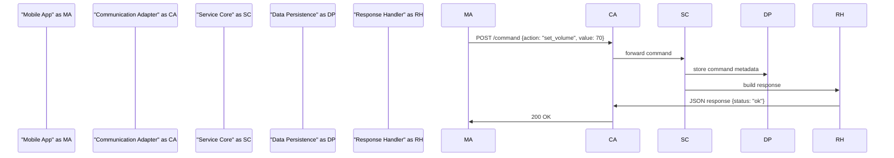
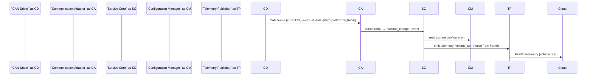
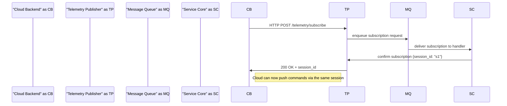

# IPC & Service Interfaces – Sequence Diagrams

## 1. Inter‑Process Communication Overview

The **Infotainment Service Layer** communicates with the outside world through three primary channels:

| Channel | Direction | Implementation |
|---------|-----------|----------------|
| **Vehicle Bus (CAN / LVDS)** | Vehicle → Service & Service → Vehicle | C++ classes wrapping the CAN driver; messages are encoded per DSOar protocol. |
| **REST / WebSocket API** | Mobile App ↔ Service | Reverse‑proxy (nginx) forwards `/command` (POST) and `/stream` (WS) to the **Communication Adapter**. |
| **Cloud Telemetry** | Service → Cloud Backend | Periodic HTTP `POST` or MQTT `publish` of JSON payloads; handled by the **Telemetry Publisher** container. |

All channels are abstracted behind C++ interfaces (`IBusListener`, `IHttpHandler`, `IMqttPublisher`) which makes it easy to swap transports without affecting the core logic.

## 2. Sequence Diagrams (Mermaid)

### 2.1 Mobile App Sends a Command → Service Processes & Replys

*Key points:*
- The mobile app uses a simple HTTP POST; the **Communication Adapter** validates the JSON payload.
- The **Service Core** persists relevant data (e.g., volume preference) via **Data Persistence**.
- The response is sent back through the same adapter; the app can immediately update UI.

### 2.2 Vehicle Bus Message Received → Service Updates Internal State

*Key points:*
- Raw CAN frames are first decoded by the **Communication Adapter**.
- The **Service Core** reacts to the parsed event, possibly reading or updating **Configuration Manager** settings.
- Telemetry is published asynchronously; the **Telemetry Publisher** does not block the main command path.

### 2.3 Cloud Telemetry Request → Service Sends Ack

*Key points:*
- The cloud initiates an HTTPS request to subscribe to a telemetry stream.
- The **Telemetry Publisher** forwards the request to the **Service Core** via an internal message queue.
- The service acknowledges with a session identifier; subsequent commands from the cloud can be routed through that session.

---
*All Mermaid diagrams above use double‑quoted labels (e.g., `"Mobile App"`), which prevents the "Syntax error in text" issue on GitHub.*